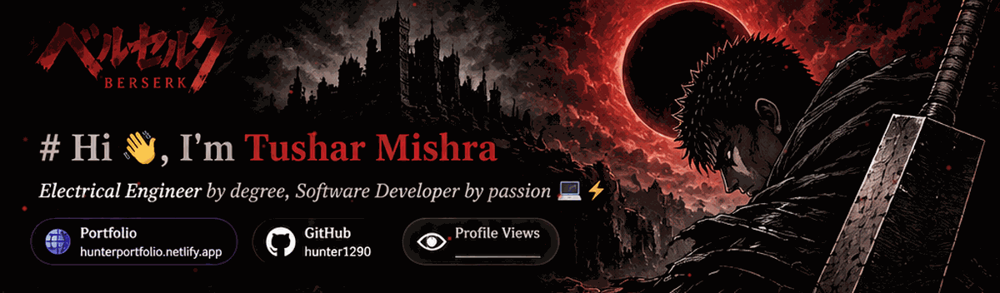

<div align="center">




# ⚔️ Hi, I'm **Tushar Mishra**

### Electrical Engineer by degree · Software Developer by passion 💻⚡

[](https://hunterportfolio.netlify.app/)
[](https://github.com/hunter1290)
[](https://github.com/hunter1290)

[](https://git.io/typing-svg)

</div>

---

## 🩸 About Me

```java
public class Tushar {
    private String role = "Electrical Engineer @ Delhi Technological University";
    private String location = "Delhi, India";
    private String[] focus = {
        "Backend Development",
        "Full-Stack Web Apps",
        "Problem Solving"
    };
    private boolean currentlyLearning = true;

    public static void main(String[] args) {
        System.out.println(
            "Building things that work, and learning what breaks them."
        );
    }
}
```

- 🎓 Delhi Technological University
- 📍 Based in Delhi, India
- 🔭 Currently building projects across the stack — from APIs to UI
- 🌱 Sharpening my backend & systems skills (Java / Spring Boot)
- 🌐 Portfolio: [hunterportfolio.netlify.app](https://hunterportfolio.netlify.app/)
- ⚡ Fun fact: started in Electrical Engineering, ended up shipping code

<div align="center">
  
</div>

## ⚔️ Tech Stack

**Languages**


**Backend & Frameworks**


**Frontend**


**Tools & Platforms**


---

## 📊 Live GitHub Stats

<div align="center">

<!-- Live stats are fetched by the external GitHub Readme Stats service. -->


</div>

<details>
<summary>🏆 GitHub Trophies</summary>
<br/>
<div align="center">
  
</div>
</details>

---

## 📌 Featured Repositories

<!-- These cards fetch repository metadata dynamically from GitHub. -->
<div align="center">
  <a href="https://github.com/hunter1290/flightInfoSystem">
    
  </a>
  <a href="https://github.com/hunter1290/The-Wincode">
    
  </a>
  <a href="https://github.com/hunter1290/Iosd-Project">
    
  </a>
  <a href="https://github.com/hunter1290/Synegywebsite">
    
  </a>
  <a href="https://github.com/hunter1290/Covidwin-Website">
    
  </a>
</div>

| Project | Description | Tech |
|---|---|---|
| [flightInfoSystem](https://github.com/hunter1290/flightInfoSystem) | Flight information system | JavaScript |
| [The-Wincode](https://github.com/hunter1290/The-Wincode) | Team Wincode website | JavaScript |
| [Iosd-Project](https://github.com/hunter1290/Iosd-Project) | Built by Team Wincode (Tushar & Yash) | CSS |
| [Synegywebsite](https://github.com/hunter1290/Synegywebsite) | Website for Synergy online tech fest | HTML |
| [Covidwin-Website](https://github.com/hunter1290/Covidwin-Website) | Website built to help during COVID situation | HTML |
| *cutshort* | *Add repository URL and description* | — |

<details>
<summary>⭐ Starred Repositories</summary>
<br/>
Check out what I've starred: [github.com/hunter1290?tab=stars](https://github.com/hunter1290?tab=stars)
</details>

---

<div align="center">
  

  ## 📫 Connect with Me

  [](https://hunterportfolio.netlify.app/)
  [](https://github.com/hunter1290)

  <br/>

  **「 Struggle. Build. Overcome. 」**

  ⭐ Thanks for stopping by — feel free to explore my repos and reach out!
</div>
