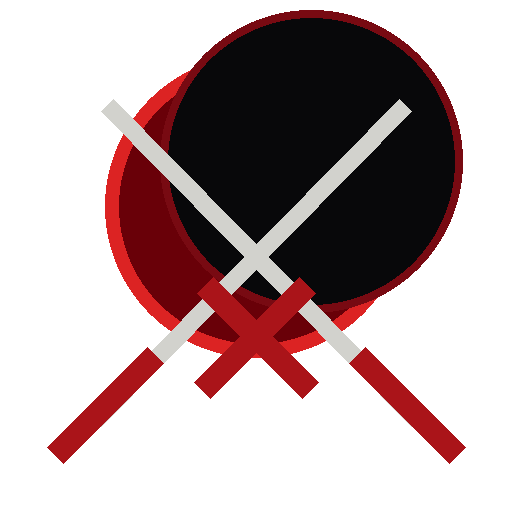
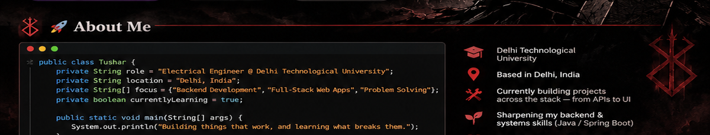
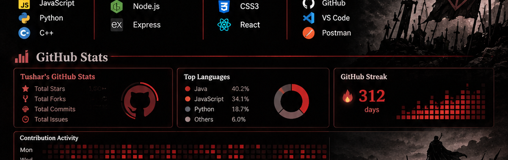

<div align="center">




# ⚔️ Hi 👋, I'm **Tushar Mishra**

### Electrical Engineer by degree, Software Developer by passion 💻⚡

[](https://hunterportfolio.netlify.app/)
[](https://github.com/hunter1290)


[](https://git.io/typing-svg)

</div>

---

<div align="center"></div>

## 🩸 About Me

```java
public class Tushar {
    private String role = "Electrical Engineer @ Delhi Technological University";
    private String location = "Delhi, India";
    private String[] focus = {
        "Backend Development",
        "Full-Stack Web Apps",
        "Problem Solving"
    };
    private boolean currentlyLearning = true;

    public static void main(String[] args) {
        System.out.println(
            "Building things that work, and learning what breaks them."
        );
    }
}
```

- 🎓 Delhi Technological University
- 📍 Based in Delhi, India
- 🔭 Currently building projects across the stack — from APIs to UI
- 🌱 Sharpening my backend & systems skills (Java / Spring Boot)
- 🌐 Portfolio: [hunterportfolio.netlify.app](https://hunterportfolio.netlify.app/)
- ⚡ Fun fact: started in Electrical Engineering, ended up shipping code

---

<div align="center"></div>

## ⚔️ Tech Stack

**Languages**


**Backend & Frameworks**


**Frontend**


**Tools & Platforms**


> 💡 Remove any badge above that doesn't reflect a tool you actually use, and add new ones the same way (find more at [shields.io](https://shields.io/) or [Simple Icons](https://simpleicons.org/)).

---

## 📊 GitHub Stats

<div align="center">


</div>

<details>
<summary>🏆 GitHub Trophies</summary>
<br>
<div align="center">
  
</div>
</details>

---

## 📌 Pinned / Featured Projects

> **Note:** GitHub lets you natively pin up to 6 repos to your profile (Profile → Customize your pins). The table below is a manual backup list — keep it in sync with what you pin, and swap in your actual **cutshort** repo link once you paste it to me.

| Project | Description | Tech |
|---|---|---|
| [flightInfoSystem](https://github.com/hunter1290/flightInfoSystem) | Flight information system | JavaScript |
| [The-Wincode](https://github.com/hunter1290/The-Wincode) | Team Wincode website | JavaScript |
| [Iosd-Project](https://github.com/hunter1290/Iosd-Project) | Built by Team Wincode (Tushar & Yash) | CSS |
| [Synegywebsite](https://github.com/hunter1290/Synegywebsite) | Website for Synergy online tech fest | HTML |
| [Covidwin-Website](https://github.com/hunter1290/Covidwin-Website) | Website built to help during COVID situation | HTML |
| *cutshort* | *Add repo link & description* | — |

<details>
<summary>⭐ Starred Repositories</summary>
<br>

Check out what I've starred: [github.com/hunter1290?tab=stars](https://github.com/hunter1290?tab=stars)

> Add specific starred repos here in the same table format once you share the links, e.g.:
>
> | Repo | Why it's starred |
> |---|---|
> | [owner/repo](https://github.com/owner/repo) | Short reason |

</details>

---

<div align="center"></div>

## 📫 Connect with Me

<div align="center">

[](https://hunterportfolio.netlify.app/)
[](https://github.com/hunter1290)

<br>

<i>⭐️ Thanks for stopping by — feel free to explore my repos and reach out!</i>

</div>
